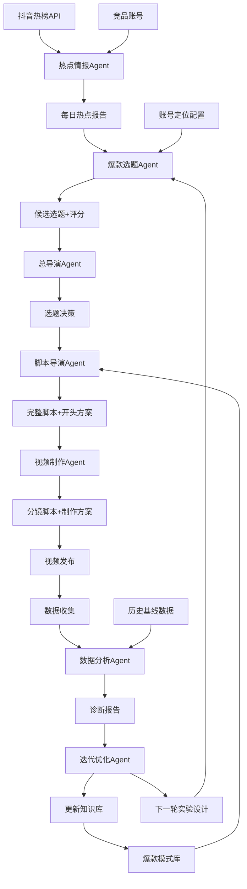
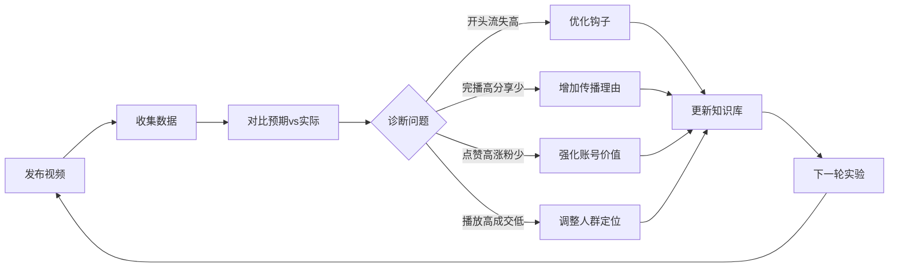

# 抖音爆款内容增长 Agent 系统架构

## 系统概述

本系统从"文案生成器"升级为"内容增长系统"，核心理念：
1. **发现爆款的能力** - 热点情报 + 竞品监控
2. **制造爆款的能力** - 选题 + 脚本 + 视频制作
3. **复制爆款的能力** - 数据反馈闭环（最重要）

## 核心 Agent 架构

### Agent 职责矩阵

| Agent | 职责 | 输入 | 输出 | 协作 |
|-------|------|------|------|------|
| **热点情报 Agent** | 发现热点和竞品动态 | 抖音热榜API、竞品账号URL | 每日热点报告 | → 选题Agent |
| **爆款选题 Agent** | 从热点中提取高潜力选题 | 热点报告、账号定位 | 候选选题列表+评分 | ← 情报Agent → 导演Agent |
| **脚本导演 Agent** | 设计爆款脚本结构 | 选题、爆款模式库 | 完整脚本+3种开头方案 | ← 选题Agent → 视频Agent |
| **视频制作 Agent** | 生成可执行的制作方案 | 脚本、账号风格 | 分镜+字幕+配音方案 | ← 脚本Agent |
| **数据分析 Agent** | 诊断视频表现问题 | 视频表现数据、历史基线 | 诊断报告+优化建议 | → 迭代Agent |
| **迭代优化 Agent** | 总结模式并更新知识库 | 诊断报告、实验记录 | 策略更新建议 | ← 数据Agent → 知识库 |
| **总导演 Agent** | 编排全局+最终决策 | 账号定位、各Agent输出 | 每日内容计划 | 编排所有子Agent |

### 数据流图



## 爆款知识库设计

### 存储结构

```
data/knowledge_base/
├── hot_cases.json          # 爆款案例库（结构化标注）
├── script_templates.json   # 脚本模板库
├── experiment_log.json     # 实验记录
└── performance_history.json # 历史表现数据
```

### 爆款案例结构

```json
{
  "id": "case_001",
  "title": "案例标题",
  "category": "技术科普",
  "metrics": {
    "views": 1000000,
    "likes": 50000,
    "shares": 10000,
    "comments": 5000
  },
  "viral_mechanism": {
    "hook_type": "冲突型",
    "emotion": "好奇+焦虑",
    "conflict_point": "认知反差",
    "spread_reason": "社交货币"
  },
  "script_structure": {
    "opening": "黄金3秒钩子",
    "pain_point": "痛点展开",
    "twist": "反转设计",
    "cta": "行动号召"
  },
  "tags": ["AI", "机器人"],
  "created_at": "2026-10-12"
}
```

### 脚本模板结构

```json
{
  "id": "template_001",
  "name": "技术科普-冲突型",
  "structure": {
    "opening_pattern": "冲突型钩子",
    "opening_variants": [
      "你以为XX是这样？其实...",
      "99%的人都误解了XX",
      "XX的真相可能让你失望"
    ],
    "middle_pattern": "痛点+解决方案",
    "ending_pattern": "CTA+悬念"
  },
  "applicable_scenarios": ["技术误解", "行业真相"],
  "success_rate": 0.75,
  "avg_engagement": 8.5
}
```

## 数据反馈闭环设计

### 闭环流程



### 诊断规则引擎

```python
# 诊断规则示例
rules = [
    {
        "condition": "completion_rate > 0.5 AND share_rate < 0.01",
        "diagnosis": "完播高但分享少 → 缺传播理由",
        "suggestion": "增加社交货币属性：让用户分享后显得有见识/有趣/有品位"
    },
    {
        "condition": "like_rate > 0.05 AND follow_rate < 0.001",
        "diagnosis": "点赞高但涨粉少 → 账号价值不明确",
        "suggestion": "强化账号定位：在视频中反复提及账号价值主张"
    }
]
```

### 爆款潜力评估器（6维度）

| 维度 | 权重 | 评估要点 |
|------|------|----------|
| 开头吸引力 | 25% | 3秒内能否抓住注意力 |
| 情绪共鸣 | 20% | 能否引发愤怒/焦虑/好奇/共鸣/搞笑 |
| 认知反差 | 20% | 是否打破常识，制造认知冲突 |
| 内容价值 | 15% | 用户能否获得实用信息或洞察 |
| 传播动机 | 10% | 用户分享的理由（社交货币/利他/表达） |
| 账号匹配度 | 10% | 与账号定位和受众的契合度 |

**评分标准**：每维度1-10分，加权计算总分（满分100）

**评级**：
- 90-100: S级（必爆）
- 80-89: A级（高潜力）
- 70-79: B级（中等）
- 60-69: C级（需优化）
- <60: D级（不建议）

## 三阶段落地计划

### Phase 1: 基础能力建设（2周）

**目标**：跑通核心流程

**任务**：
1. ✅ 搭建数据模型和知识库结构
2. ✅ 实现热点情报Agent（接入抖音热榜API）
3. ✅ 实现选题Agent（基础评分）
4. ✅ 实现脚本Agent（3种开头变体）
5. ✅ 实现爆款评估器（6维度）

**验收标准**：
- 能自动获取热点并生成选题
- 能输出完整脚本+开头方案
- 能评估脚本爆款潜力

### Phase 2: 数据闭环打通（2周）

**目标**：建立反馈机制

**任务**：
1. 实现视频制作Agent（分镜生成）
2. 实现数据分析Agent（诊断规则引擎）
3. 实现迭代优化Agent（知识库更新）
4. 打通数据反馈闭环
5. 积累10+爆款案例库

**验收标准**：
- 能录入视频表现数据
- 能自动诊断问题并给出建议
- 能根据数据更新知识库权重

### Phase 3: 智能优化升级（2周）

**目标**：提升自动化和智能化

**任务**：
1. 实现总导演Agent（全局编排）
2. 实现每日工作流自动化
3. 优化爆款评估器（基于历史数据训练权重）
4. 实现竞品监控和对比分析
5. 建立A/B测试框架

**验收标准**：
- 每日自动生成内容计划
- 能对比竞品策略
- 能设计并追踪A/B实验
- 爆款率提升30%+

## 技术栈

- **语言**：Python 3.9+
- **AI接口**：OpenAI兼容接口（支持自定义base_url）
- **数据存储**：JSON文件（轻量级，易调试）
- **日志**：logging模块
- **类型注解**：完整type hints
- **API**：抖音热榜接口

## 部署架构

```
douyin-viral-rewrite-agent/
├── src/
│   ├── agents/          # 7个核心Agent
│   ├── core/            # 核心模块（评估器、知识库、数据闭环）
│   └── pipeline/        # 工作流编排
├── config/              # 配置文件
├── data/                # 数据存储
│   └── knowledge_base/  # 知识库
├── logs/                # 日志文件
└── tests/               # 测试用例
```

## 关键设计原则

1. **松耦合**：Agent之间通过数据模型通信，可单独运行和测试
2. **可解释**：所有评分和诊断都有明确的理由和依据
3. **可迭代**：知识库支持动态更新，权重可调整
4. **可追踪**：完整的实验记录和日志
5. **可复用**：模板和模式库支持跨账号复用

## 风险与应对

| 风险 | 影响 | 应对措施 |
|------|------|----------|
| 抖音API限流 | 无法获取热点 | 缓存机制+多账号轮换 |
| AI生成质量不稳定 | 脚本质量波动 | 人工审核+模板约束 |
| 数据反馈延迟 | 闭环周期长 | 缩短数据采集周期，每日复盘 |
| 爆款模式过时 | 效果下降 | 定期更新知识库，淘汰旧模式 |

## 成功指标

- **效率提升**：内容生产时间从4小时→1小时
- **爆款率**：从10%→30%（播放量>10万）
- **涨粉成本**：降低50%
- **复用率**：爆款模式库覆盖率>80%
